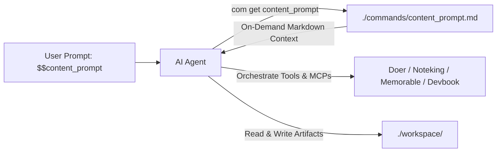

# Octopus

```text
 ▄▄▄   ▄▄▄▄ ▄▄▄▄▄▄ ▄▄▄  ▄▄▄▄  ▄▄ ▄▄  ▄▄▄▄ 
██▀██ ██▀▀▀   ██  ██▀██ ██▄█▀ ██ ██ ███▄▄ 
▀███▀ ▀████   ██  ▀███▀ ██    ▀███▀ ▄▄██▀ 
```

Octopus is a lightweight harness for AI agents. Not a skill manifest, not a plugin zoo, and not another abstraction layer wrapped around your tools. It is a command protocol and a workspace manager.

## The Core Idea

Most agent setups front-load context: skill descriptions, tool schemas, system instructions. Thousands of tokens are gone before you type a word.

Octopus loads nothing until you invoke it. [`AGENTS.md`](AGENTS.md) carries one rule: when a message starts with `$$name`, run `com get name`. The command's Markdown is fetched on demand, used, and never bloats the session.



## Tools

Octopus is built on two small Bash utilities in `bin/`:

### `bin/com` — Command Definitions (`$$`)

Creates and reads `$$` command definitions in `./commands/<name>.md`. Each file is a plain Markdown runbook: usage, args, description, and steps. It can call CLIs, chain MCP servers, ask questions, and write files.

```bash
com                  # Interactive mode (pick add or get via fzf / select)
com add my_workflow  # Create ./commands/my_workflow.md
com get my_workflow  # Print ./commands/my_workflow.md
com help             # Show CLI usage
```

Every command file starts with a three-line header followed by execution steps (see [`COMMANDS.md`](COMMANDS.md) for the full specification):

```markdown
Usage: $$<name> [args]
Args: <args or "-">
Description: <one-line summary>

Tool use is allowed for this command.

1. Step one...
2. Step two...
```

Built-in conventions:

| Command | Behavior |
| --- | --- |
| `$$` | Alias for `$$help` |
| `$$help` | List available commands and usage summary |
| `$$help <command>` | Print the full Markdown definition for `<command>` |
| `$$commands` | Display a formatted table of all commands in `./commands` |

### `bin/work` — Workspace Manager

Creates isolated task folders in `./workspace` and archives finished runs to `./archive`, with automatic timestamp deduplication (`-YYYYMMDD-HHMMSS`) and `fzf` selection.

```bash
work                      # Interactive mode (pick add or archive via fzf / select)
work add q4-planning      # Create ./workspace/q4-planning
work archive q4-planning  # Move ./workspace/q4-planning to ./archive/q4-planning
work help                 # Show CLI usage
```

## Isolation

`commands/`, `workspace/`, and `archive/` are gitignored. Version the harness, keep your workflows private.

## The Ecosystem

Octopus is the orchestration layer across four companion MCP tools:

- [**Noteking**](https://github.com/leouofa/noteking): research and structured notes.
- [**Doer**](https://github.com/leouofa/doer): projects, todos, backlog.
- [**Memorable**](https://github.com/leouofa/memorable): persistent memory and writing rulesets.
- [**Devbook**](https://github.com/leouofa/devbook): versioned prompt templates.

A single `$$` command can string all four together. The pattern: pull a backlog item from Doer, attach research from Noteking, recall conventions from Memorable, and fill a parameterized prompt in Devbook.

### Example Workflows

#### 1. Backlog to Prompt (`$$content_prompt`)

Pulls an idea from **Doer** and merges an outline into a **Devbook** prompt template:

```markdown
Usage: $$content_prompt
Args: -
Description: Pull todos from `content-ideas` in Doer, pick one, and draft an article prompt

Tool use is allowed for this command.

1. Fetch items from the `content-ideas` todo list in Doer (`doer-tui` or Doer MCP).
2. Present the items as a numbered list and ask the user which one to work on.
3. Produce an Article Title and a 3–6 section outline with brief bullet points.
4. Fetch Devbook template #6 and replace `{{ article title }}` and `{{ article bullet points }}` with the generated title and outline. Return the merged prompt without modifying the stored template.
```

#### 2. Voice-Consistent Summary (`$$readable_summary`)

Loads a writing ruleset from **Memorable** only when needed, keeping style rules out of the base system prompt:

```markdown
Usage: $$readable_summary [text]
Args: `[text]`
Description: Rewrite text into a concise summary in the user's voice

Tool use is allowed for this command.

1. Use the text provided in the message, or ask the user to paste it.
2. Fetch the writing ruleset from Memorable memory #5 via `memorable_get_memory({ id: 5 })`.
3. Rewrite the text into a concise, direct summary following that ruleset.
```

#### 3. Four-Tool Synthesis (`$$deep_spec`)

Chains all four tools into an isolated workspace artifact:

1. **Doer:** Pick the next task from an active project todo list.
2. **Noteking:** Pull architecture notes and research tagged for that project.
3. **Memorable:** Recall relevant past decisions and coding conventions via semantic search.
4. **Devbook:** Inject the task, notes, and constraints into a parameterized prompt template and write the result to `./workspace/<feature>/prompt.md`.

## Quickstart

Clone the repo, put `bin/` on `PATH`, create the three local directories, then add your first command and workspace:

```bash
git clone https://github.com/leouofa/octopus.git
cd octopus
export PATH="$PWD/bin:$PATH"

mkdir -p commands workspace archive

com add hello
work add my-first-task
```

Write the command in `./commands/hello.md`, then run `$$hello` in your agent session.

## Repository Contents

| Path | Contents |
| --- | --- |
| [`README.md`](README.md) | Repo overview, ecosystem links, and quickstart |
| [`AGENTS.md`](AGENTS.md) | Agent guide and `$$` command protocol |
| [`COMMANDS.md`](COMMANDS.md) | Detailed `$$` command specification and `com` usage |
| [`bin/com`](bin/com) | CLI tool to add and read command definitions in `./commands` |
| [`bin/work`](bin/work) | CLI tool to add and archive workspaces in `./workspace` and `./archive` |
| `commands/` | Local command Markdown files (gitignored) |
| `workspace/` | Active workspace folders (gitignored) |
| `archive/` | Archived workspace folders (gitignored) |

---

**The point:** context is a budget. Spend it on the task, not the scaffolding.
