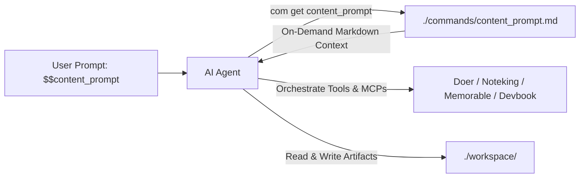

# Octopus

```text
 ▄▄▄   ▄▄▄▄ ▄▄▄▄▄▄ ▄▄▄  ▄▄▄▄  ▄▄ ▄▄  ▄▄▄▄ 
██▀██ ██▀▀▀   ██  ██▀██ ██▄█▀ ██ ██ ███▄▄ 
▀███▀ ▀████   ██  ▀███▀ ██    ▀███▀ ▄▄██▀ 
```

Octopus is a lightweight harness for AI agents. Not a skill manifest, not a plugin zoo, and not another abstraction layer wrapped around your tools. It is a command protocol and a workspace manager.

## The Core Idea

Most agent setups front-load context: skill descriptions, tool schemas, system instructions. Thousands of tokens are gone before you type a word.

Octopus loads nothing until you invoke it. [`AGENTS.md`](AGENTS.md) carries one rule: when a message starts with `$$name`, run `com get name`. The command's Markdown is fetched on demand, used, and never bloats the session.



## Tools

Octopus relies on two lightweight companion CLI tools:

### [`com`](https://github.com/octopus-harness/octo-com) — Command Definitions (`$$`)

Creates and reads `$$` command definitions in `./commands/<name>.md`. Each file is a plain Markdown runbook: usage, args, description, and steps. It can call CLIs, chain MCP servers, ask questions, and write files.

```bash
com                  # Interactive mode (pick add or get via fzf / select)
com add my_workflow  # Create ./commands/my_workflow.md
com get my_workflow  # Print ./commands/my_workflow.md
com help             # Show CLI usage
```

Configure `com` to point to the repository's `commands/` directory so commands are universally accessible from any folder or terminal session:

```bash
# Set a persistent global commands directory (stored in ~/.config/octo-com/config.json)
com config set-dir /path/to/octopus/commands

# Inspect active configuration
com config get-dir
com config
```

Every command file starts with a three-line header followed by execution steps (see [`COMMANDS.md`](COMMANDS.md) for the full specification):

```markdown
Usage: $$<name> [args]
Args: <args or "-">
Description: <one-line summary>

Tool use is allowed for this command.

1. Step one...
2. Step two...
```

Built-in conventions:

| Command | Behavior |
| --- | --- |
| `$$` | Alias for `$$help` |
| `$$help` | List available commands and usage summary |
| `$$help <command>` | Print the full Markdown definition for `<command>` |
| `$$commands` | Display a formatted table of all commands in `./commands` |

### [`work`](https://github.com/octopus-harness/octo-work) — Workspace Manager

Creates isolated task folders in `./workspace` and archives finished runs to `./archive`, with automatic timestamp deduplication (`-YYYYMMDD-HHMMSS`) and `fzf` selection.

```bash
work                      # Interactive mode (pick add or archive via fzf / select)
work add q4-planning      # Create ./workspace/q4-planning
work archive q4-planning  # Move ./workspace/q4-planning to ./archive/q4-planning
work help                 # Show CLI usage
```

## Isolation

`commands/`, `workspace/`, and `archive/` are gitignored. Version the harness, keep your workflows private.

## The Ecosystem

Octopus is the orchestration layer across four companion MCP tools:

- [**Noteking**](https://github.com/leouofa/noteking): research and structured notes.
- [**Doer**](https://github.com/leouofa/doer): projects, todos, backlog.
- [**Memorable**](https://github.com/leouofa/memorable): persistent memory and writing rulesets.
- [**Devbook**](https://github.com/leouofa/devbook): versioned prompt templates.

A single `$$` command can string all four together. The pattern: pull a backlog item from Doer, attach research from Noteking, recall conventions from Memorable, and fill a parameterized prompt in Devbook.

### Example Workflows

#### 1. Backlog to Prompt (`$$content_prompt`)

Pulls an idea from **Doer** and merges an outline into a **Devbook** prompt template:

```markdown
Usage: $$content_prompt
Args: -
Description: Pull todos from `content-ideas` in `doer`, pick one, and draft an article prompt

Tool use is allowed for this command.

1. Use `doer` MCP to locate the todo list named `content-ideas` and fetch its current todo items.
2. Present the fetched items as a numbered list and ask the user which single item to work on.
3. Once the user selects an item, produce an Article Title and Suggested Outline (3 to 6 sections with brief bullet points).
4. Retrieve the prompt template from Devbook MCP (id 6), and replace `{{ article title }}` and `{{ article bullet points }}` with the generated title and outline. Return the merged prompt to the user without modifying the stored template in Devbook.
```

#### 2. Voice-Consistent Summary (`$$readable_summary`)

Loads a writing ruleset from **Memorable** only when needed, keeping style rules out of the base system prompt:

```markdown
Usage: $$readable_summary [text]
Args: `[text]`
Description: Rewrite text into a concise summary in the user's voice

Tool use is allowed for this command.

1. If the user provided text in the message, use that; otherwise ask the user to paste the text.
2. Retrieve and apply the writing ruleset from Memorable MCP `memorable_get_memory({ id: 5 })`.
3. Rewrite the text into a concise, readable summary matching the user's voice (clear, direct, conversational, no corporate filler).
```

#### 3. Four-Tool Synthesis (`$$deep_spec`)

Chains all four tools into an isolated workspace artifact:

1. **Doer:** Pick the next task from an active project todo list.
2. **Noteking:** Pull architecture notes and research tagged for that project.
3. **Memorable:** Recall relevant past decisions and coding conventions via semantic search.
4. **Devbook:** Inject the task, notes, and constraints into a parameterized prompt template and write the result to `./workspace/<feature>/prompt.md`.

## Universal Multi-Agent & Terminal Workflow

### Cross-System, Multi-Agent Ready

You can work inside the `octopus` repository itself—[`AGENTS.md`](AGENTS.md) is located here and workspace runs can live directly in `./workspace`. But because `com` and `work` are system-wide CLI tools, the workflow isn't confined to a single directory or agent harness. You can run tasks from any project across your entire machine, integrating with multiple agents simultaneously:

- **Antigravity**
- **Claude Code**
- **OpenCode**
- **Cursor**
- Any CLI or IDE agent equipped with shell access

Point `com` to your commands directory once (`com config set-dir`), and any agent anywhere on your system can run `com get <name>` to load on-demand context via the `$$` protocol.

### A Heaven for Heavy Terminal Users

Everything in Octopus, `com`, and `work` is built keyboard-first:

- **VIMified & TUI-Driven:** Interactive modes leverage `fzf` fuzzy filtering with VIM navigation (`j`/`k`, `/`), instant command previews, and reverse layouts.
- **Fast Interactive Pickers:** Running bare `com` or `work` immediately opens a clean TUI selector to add, inspect, or archive items without having to remember flags or subcommands.
- **Scriptable & Pipe-Friendly:** Every command falls back gracefully to non-interactive CLI flags and standard POSIX streams when piped or run inside automation.

## Quickstart

Clone the repo, install the companion CLI tools [`com`](https://github.com/octopus-harness/octo-com) and [`work`](https://github.com/octopus-harness/octo-work) into your `PATH`, create the three local directories, then add your first command and workspace:

```bash
git clone https://github.com/leouofa/octopus.git
cd octopus

# Ensure com and work are installed and on your PATH:
# (see https://github.com/octopus-harness/octo-com and https://github.com/octopus-harness/octo-work)

# Point com to this repository's commands directory so commands are accessible everywhere
com config set-dir "$PWD/commands"

mkdir -p commands workspace archive

com add hello
work add my-first-task
```

Write the command in `./commands/hello.md`, then run `$$hello` in your agent session.

## Repository Contents

| Path | Contents |
| --- | --- |
| [`README.md`](README.md) | Repo overview, ecosystem links, and quickstart |
| [`AGENTS.md`](AGENTS.md) | Agent guide and `$$` command protocol |
| [`COMMANDS.md`](COMMANDS.md) | Detailed `$$` command specification and `com` usage |
| `commands/` | Local command Markdown files (gitignored) |
| `workspace/` | Active workspace folders (gitignored) |
| `archive/` | Archived workspace folders (gitignored) |

---

**The point:** context is a budget. Spend it on the task, not the scaffolding.
