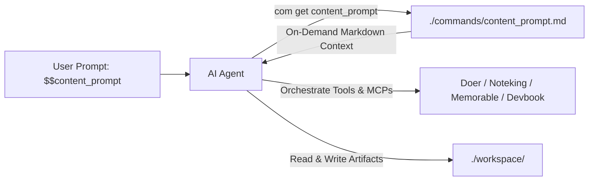

# Octopus

```text
                        ___
                     .-'   '-.
                    /  o   o  \
                   |     ^     |
                    \  '---'  /
                  _.-'       '-._
               .-'  /   | |   \  '-.
              /    /   /   \   \    \
             (    (   (     )   )    )
              \    \   \   /   /    /
               '-._ '._ \ / _.' _.-'
                   '---'   '---'

   ____   _____ _______ ____  _____  _    _  _____ 
  / __ \ / ____|__   __/ __ \|  __ \| |  | |/ ____|
 | |  | | |       | | | |  | | |__) | |  | | (___  
 | |  | | |       | | | |  | |  ___/| |  | |\___ \ 
 | |__| | |____   | | | |__| | |    | |__| |____) |
  \____/ \_____|  |_|  \____/|_|     \____/|_____/ 
```

**Build your own personal toolset of agent commands, automate multi-MCP workflows, and manage isolated workspaces—with zero upfront context bloat.**

Octopus is a lightweight command protocol and workspace harness for AI coding agents. Inspired by **Antigravity's skills**—but designed to be leaner, more composable, and more powerful—Octopus replaces bloated, always-loaded skill manifests with on-demand Markdown commands (`$$`) fetched via a tiny CLI (`bin/com`) alongside clean workspace lifecycle tools (`bin/work`).

---

## Why Octopus?

Modern AI agents support "skills" and MCP tools, but loading dozens of skill descriptions, schemas, and system instructions into every session consumes thousands of tokens before you even send your first prompt.

Octopus flips this model:

- **Zero Upfront Context Overhead:** The agent only needs to know a single rule in [`AGENTS.md`](AGENTS.md): *"When a message starts with `$$<name>`, run `com get <name>`."* No command instructions are loaded into the context window until the exact moment you invoke them.
- **Inspired by Antigravity's Skills, Built for Power:** Unlike static skill definitions, an Octopus `$$` command is a plain Markdown runbook that can orchestrate arbitrary CLI tools, chain multiple MCP servers together, ask interactive clarifying questions, and write outputs to isolated workspaces.
- **First-Class Workspace Isolation:** With `bin/work`, you can spin up clean task folders inside `./workspace` and archive completed runs to `./archive` (with automatic timestamp deduplication and interactive `fzf` selection).
- **Private by Default:** Your `./commands`, `./workspace`, and `./archive` directories are gitignored out of the box—allowing you to version-control the harness while keeping your personal workflows, prompts, and active scratchpads completely private.

---

## How It Works



---

## The `$$` Command System (`bin/com`)

In any agent session inside this repository, a message starting with `$$` triggers a command from `./commands/<name>.md`.

### Built-in Conventions

| Command | Description |
| --- | --- |
| `$$` | Alias for `$$help` |
| `$$help` | List available commands and usage summary |
| `$$help <command>` | Print the full Markdown definition for a specific command |
| `$$commands` | Display a formatted table of all commands in `./commands` |

### Managing Commands with `com`

`bin/com` is a lightweight Bash utility (with interactive `fzf` support when run without arguments) for creating and reading command definitions:

```bash
# Interactively choose an action (add or get) with fzf / select
com

# Create a new command at ./commands/my_workflow.md
com add my_workflow

# Print the Markdown instructions for ./commands/my_workflow.md
com get my_workflow

# Show CLI usage
com help
```

### Command File Format

Every file in `./commands/<name>.md` starts with a three-line header followed by the step-by-step instructions the agent should execute:

```markdown
Usage: $$<name> [args]
Args: <args or "-">
Description: <one-line summary>

Tool use is allowed for this command.

1. Step one...
2. Step two...
```

See [`COMMANDS.md`](COMMANDS.md) for the full command specification.

---

## Workspace Management (`bin/work`)

Instead of scattering scratch files across your filesystem or polluting the repository root, Octopus keeps all active work inside `./workspace/<name>` and rotates finished work into `./archive/<name>`.

```bash
# Interactively choose to add or archive a workspace (uses fzf if installed)
work

# Create a new isolated workspace at ./workspace/q4-planning
work add q4-planning

# Move ./workspace/q4-planning to ./archive/q4-planning
# (Automatically appends a -YYYYMMDD-HHMMSS timestamp if the archive name already exists)
work archive q4-planning

# Show CLI usage
work help
```

---

## Multi-MCP Automation Ecosystem

Octopus shines when used as the orchestration layer ("eight arms") connecting specialized MCP servers and CLI/TUI tools. Because each `$$` command loads only the exact instructions needed for a workflow, you can build sophisticated pipelines across multiple tools without overwhelming the model's context.

### Companion Tools

These four projects are designed to work seamlessly together inside Octopus workflows:

| Project | Role in the Ecosystem | What It Manages |
| --- | --- | --- |
| [**Noteking**](https://github.com/leouofa/noteking) | Knowledge & Research | Projects, structured Markdown notes, pinned references, and attachments |
| [**Doer**](https://github.com/leouofa/doer) | Task & Idea Tracking | Projects, actionable todo lists, and backlog items (`doer-tui` & MCP) |
| [**Memorable**](https://github.com/leouofa/memorable) | Semantic Memory & Voice | Persistent memories, writing rulesets, persona guidelines, and semantic search |
| [**Devbook**](https://github.com/leouofa/devbook) | Prompt Engineering Library | Versioned prompt templates with `{{ variable }}` placeholders and project grouping |

### Example Workflows

#### 1. Automated Content & Advanced Prompt Generation (`$$content_prompt`)
Chain **Doer** and **Devbook** to turn raw backlog ideas into structured, high-leverage prompts ready to feed into complex reasoning models:

```markdown
Usage: $$content_prompt
Args: -
Description: Pull todos from `content-ideas` in doer-tui, pick one, and draft an article prompt

Tool use is allowed for this command.

1. Use `doer-tui` (or available `doer` MCP tools) to locate the todo list named `content-ideas` and fetch its current todo items.
2. Present the fetched items as a numbered list and ask the user which single item to work on.
3. Once the user selects an item, produce an Article Title and Suggested Outline (3 to 6 sections with brief bullet points).
4. Retrieve the prompt template from Devbook MCP (id 6), and replace `{{ article title }}` and `{{ article bullet points }}` with the generated title and outline. Return the merged prompt to the user without modifying the stored template in Devbook.
```

#### 2. Voice-Consistent Summarization (`$$readable_summary`)
Fetch a curated writing ruleset from **Memorable** on demand so the agent rewrites text in your exact voice without keeping style guides permanently in your system prompt:

```markdown
Usage: $$readable_summary [text]
Args: `[text]`
Description: Rewrite the provided text into a concise, readable summary in the user's voice

Tool use is allowed for this command.

1. If the user provided text in the message, use that; otherwise ask the user to paste the text.
2. Retrieve and apply the writing ruleset from Memorable memory #5 via `memorable_get_memory({ id: 5 })`.
3. Rewrite the text into a concise, readable summary matching the user's voice (clear, direct, conversational, no corporate filler).
```

#### 3. Full Four-Tool Synthesis Pipeline (Doer + Noteking + Memorable + Devbook)
You can combine all four companion tools in a single `$$deep_spec` command to assemble rich prompts for frontier models:
1. **[Doer](https://github.com/leouofa/doer):** Pick the next feature or research task from an active project todo list.
2. **[Noteking](https://github.com/leouofa/noteking):** Pull architecture notes and domain research tagged for that project.
3. **[Memorable](https://github.com/leouofa/memorable):** Recall relevant past decisions, coding conventions, or stylistic preferences via semantic search.
4. **[Devbook](https://github.com/leouofa/devbook):** Inject the task, research notes, and constraints into a parameterized master prompt template—saving the final assembled prompt into `./workspace/<feature>/prompt.md` to feed into a deep reasoning model.

---

## Quickstart

### 1. Clone the repository and add `bin/` to your `PATH`

```bash
git clone https://github.com/leouofa/octopus.git
cd octopus

# Add bin/com and bin/work to your PATH (add to ~/.zshrc or ~/.bashrc)
export PATH="$PWD/bin:$PATH"
```

### 2. Initialize local directories

Because `commands/`, `workspace/`, and `archive/` are gitignored to keep your personal workflows private, ensure they exist locally:

```bash
mkdir -p commands workspace archive
```

### 3. Create your first command and workspace

```bash
# Create a new command definition
com add hello

# Create an active workspace folder
work add my-first-task
```

Add a header and instructions to `./commands/hello.md`, start your agent session in the repo root, and run `$$hello`!

---

## Repository Contents

| Path | Description |
| --- | --- |
| [`README.md`](README.md) | Project overview, philosophy, ecosystem links, and quickstart |
| [`AGENTS.md`](AGENTS.md) | Agent instructions and `$$` command execution rules |
| [`COMMANDS.md`](COMMANDS.md) | Detailed `$$` command protocol and `com` CLI usage |
| [`bin/com`](bin/com) | CLI tool to create (`add`) and read (`get`) command Markdown files |
| [`bin/work`](bin/work) | CLI tool to create (`add`) and archive (`archive`) workspaces |
| `commands/` | Local `$$` command Markdown files (gitignored) |
| `workspace/` | Active task workspaces (gitignored) |
| `archive/` | Timestamped archived workspaces (gitignored) |
